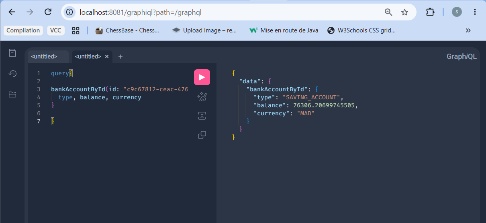
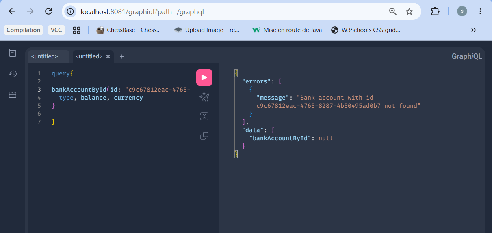
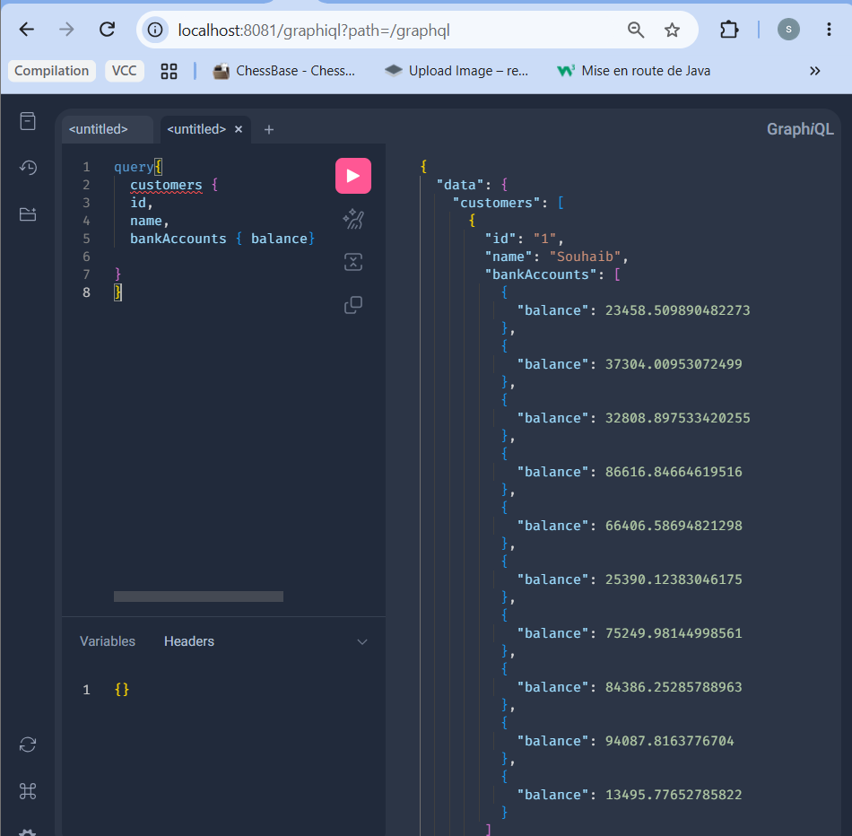
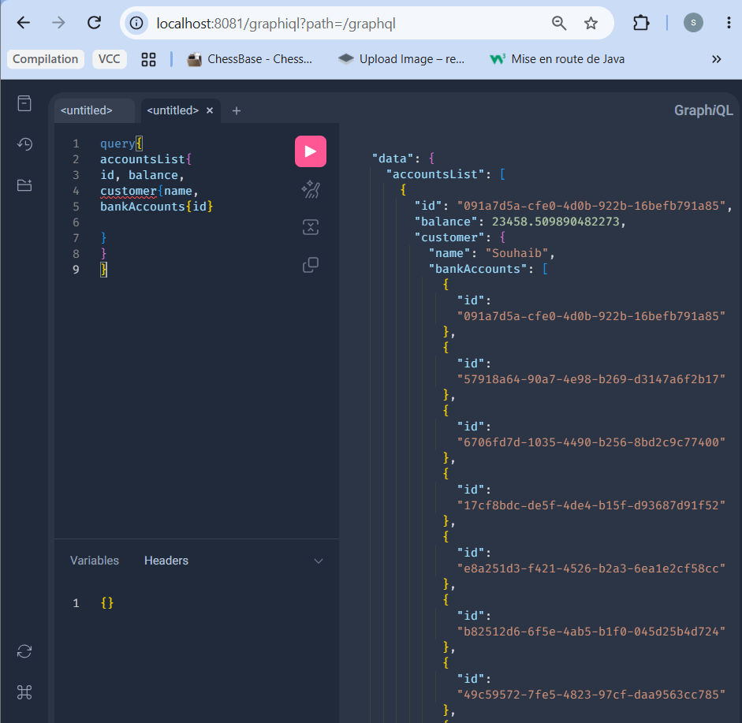
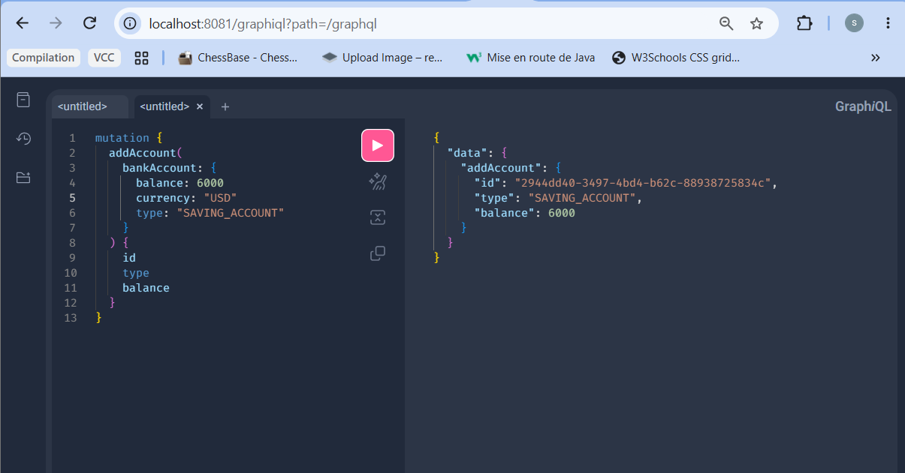
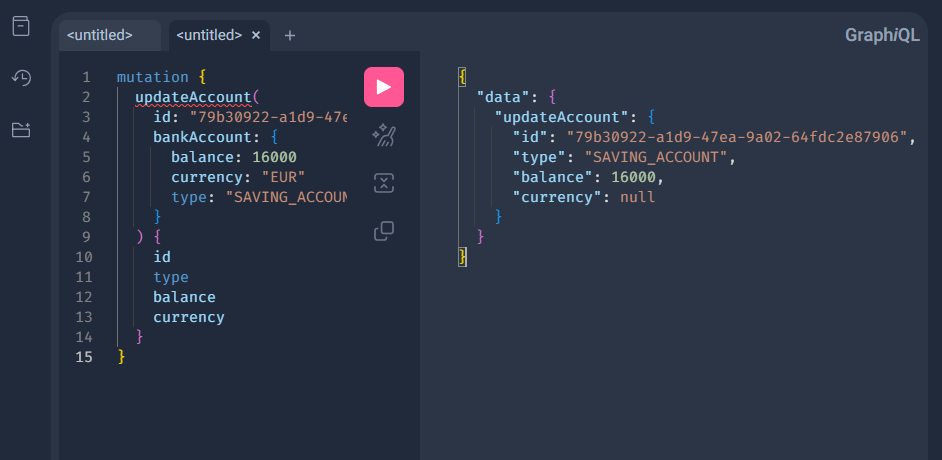
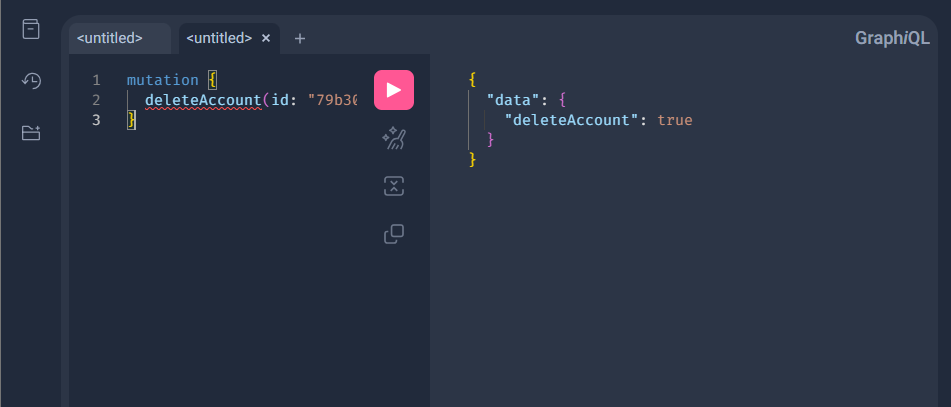
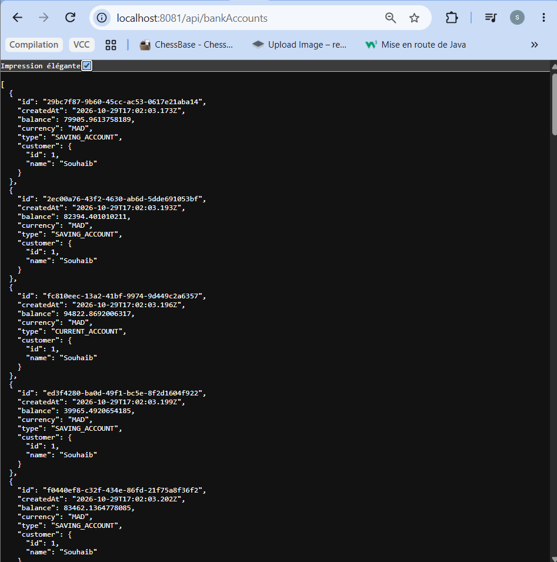

# Activite Pratique N 1 - Implementation d un micro-service avec Spring Boot

Ce projet represente la premiere activite pratique realisee dans le cadre de notre formation en genie logiciel. Il vise a concevoir, developper et tester un micro-service complet de gestion de comptes bancaires en exploitant tout l ecosysteme de Spring Boot, de la persistence des donnees jusqu aux architectures avancees comme REST, Spring Data REST et GraphQL.

---

## Table des matieres
1. [Description du projet et Objectifs](#description-du-projet-et-objectifs)
2. [Technologies Utilisees](#technologies-utilisees)
3. [Architecture et Etapes de Realisation](#architecture-et-apes-de-realisation)
4. [Base de donnees H2 et Couche DAO](#base-de-donnees-h2-et-couche-dao)
5. [Documentation Swagger / OpenAPI](#documentation-swagger--openapi)
6. [Tests via GraphiQL (GraphQL)](#tests-via-graphiql-graphql)
7. [Tests des Web Services REST](#tests-des-web-services-rest)

---

## Description du projet et Objectifs

L objectif principal de ce projet est de manipuler l ecosysteme Spring pour batir une architecture micro-service robuste et modulaire. Le parcours pratique aborde les points suivants :
1. La mise en place d un projet Spring Boot configure avec les starter dependances indispensables (*Web, Spring Data JPA, H2, Lombok*).
2. La modelisation et la creation de l entite JPA `Compte` associee a son interface `CompteRepository` basee sur Spring Data.
3. La validation et le test de la couche DAO ainsi que le developpement des controleurs RESTful.
4. L integration d une documentation interactive des API grace a **Swagger / OpenAPI**.
5. L exposition simplifiee de services via **Spring Data REST** en utilisant des projections personnalisees.
6. Le decoupage en couches metier propres avec l introduction des DTOs, des mappers et l implementation d une API **GraphQL** pour des requetes et mutations dynamiques.

---

## Technologies Utilisees

Le projet repose sur une stack technique moderne et standardisee, telle que definie dans le fichier de configuration Maven (`pom.xml`) :

* **Langage et Runtime :** Java 17
* **Framework Principal :** Spring Boot 4.1.2
* **Web et API :** Spring Web MVC, Spring Data REST
* **API et Requetes Avancees :** Spring GraphQL
* **Persistence de Donnees :** Spring Data JPA, Base de donnees en memoire H2
* **Documentation et Interface :** Springdoc OpenAPI Starter WebMVC UI (v3.2.0)
* **Productivite du Code :** Project Lombok
* **Tests et Validation :** Spring Boot Starter Test pour JPA, GraphQL et WebMVC

---

## Architecture et Etapes de Realisation

* **Etape 1 :** Initialisation et configuration du projet Spring Boot avec les dependances Web, JPA, H2 et Lombok.
* **Etape 2 et 3 :** Creation de l entite JPA `Compte` et de l interface repository pour la gestion des donnees.
* **Etape 4 a 6 :** Developpement des services web REST et validation des flux de donnees.
* **Etape 7 :** Generation et verification de la documentation OpenAPI/Swagger.
* **Etape 8 a 10 :** Structuration de la couche metier, integration des DTOs, des mappers et des projections Spring Data REST.
* **Etape 11 :** Mise en place et test du service web GraphQL pour la manipulation fine des donnees.

---

## Base de donnees H2 et Couche DAO

La base de donnees en memoire H2 permet d initialiser et de visualiser instantanement les enregistrements de test de l application.

* **Console H2 - Visualisation de la table `BANK_ACCOUNT` :**
  

---

## Documentation Swagger / OpenAPI

La documentation genere automatiquement un catalogue interactif listant l ensemble des endpoints REST disponibles, facilitant ainsi les tests et l exploration des ressources (`/bankAccounts`).

* **Interface Swagger UI :**
  

---

## Tests via GraphiQL (GraphQL)

L interface GraphiQL offre un environnement de test interactif pour executer des requêtes et des mutations ciblees sur le micro-service.

### 1. Interface GraphiQL (Accueil et Documentation)

### 2. Requetes (Queries)
* **Recherche d un compte par son identifiant :**
  
* **Gestion des erreurs (Compte non trouve) :**
  
* **Affichage de la liste des clients et de leurs soldes :**
  
* **Affichage de la liste des comptes avec details clients :**
  

### 3. Mutations (Ajout, Modification, Suppression)
* **Ajout d un nouveau compte (`addAccount`) :**
  
* **Mise a jour d un compte (`updateAccount`) :**
  
* **Suppression d un compte (`deleteAccount`) :**
  

---

## Tests des Web Services REST

L endpoint REST expose les donnees sous un format JSON structure, permettant de verifier la restitution correcte des informations et des relations associees.

* **Reponse JSON de l API REST (`/api/bankAccounts`) :**
  
